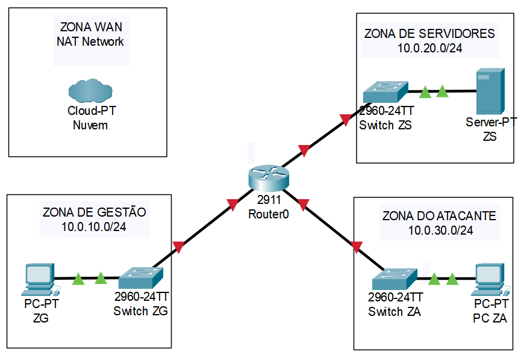

# 🛡️ InfraSec Lab

**Segmentação, Monitoramento e Resposta a Incidentes em Ambiente de Rede Simulado**

---

## 📑 Sumário
- [Sobre o projeto](#sobre-o-projeto)
- [Arquitetura](#arquitetura)
- [Stack técnica](#stack-técnica)
- [Roadmap](#roadmap)
- [Acompanhamento do projeto](#acompanhamento-do-projeto)
- [Aviso ético](#aviso-ético)
- [Autor](#autor)

---

## Sobre o projeto
Laboratório prático que simula, do zero, uma rede corporativa segmentada —
cobrindo firewall, gestão de identidade, monitoramento e resposta a
incidentes. O objetivo é aplicar na prática conceitos de infraestrutura e
cibersegurança, documentando cada etapa como um projeto real de governança
de TI (sprints, issues, pull requests e board de acompanhamento).

## Arquitetura

Detalhes de endereçamento e segmentação em [`docs/enderecamento.md`](docs/enderecamento.md).

## Stack técnica

| Camada | Ferramentas |
|---|---|
| 🌐 **Rede e Firewall** | VirtualBox · pfSense |
| 🔑 **Identidade (IAM)** | Samba AD DC |
| 🖥️ **Servidores** | Ubuntu Server 22.04 · Kali Linux |
| 🔵 **Blue Team / Monitoramento** | Wazuh (SIEM) · Suricata (IDS) · Fail2ban · OpenVAS |
| 🔴 **Red Team / Ofensivo** | Nmap · Hydra · Metasploit |

## Roadmap

| # | Sprint | Status |
|:---:|---|:---:|
| 0 | Planejamento e Governança | ✅ |
| 1 | Rede e Firewall | ⏳ |
| 2 | Servidores e Hardening | ⏳ |
| 3 | IAM — Samba AD DC | ⏳ |
| 4 | Monitoramento (SIEM/IDS) | ⏳ |
| 5 | Ataque e Detecção (MITRE ATT&CK) | ⏳ |
| 6 | Vulnerabilidades e Resposta a Incidente | ⏳ |
| 7 | Vitrine | ⏳ |

## Acompanhamento do projeto
- 📋 [Board do projeto (GitHub Projects)](../../projects)
- 📓 [Diário de bordo e progresso](docs/progresso.md)
- 💼 [Plano de conteúdo LinkedIn](docs/linkedin-plan.md)

## Aviso ético
> ⚠️ Toda atividade ofensiva simulada neste projeto ocorre **exclusivamente**
> dentro da rede isolada deste laboratório, sem acesso à internet externa.
> Nenhuma técnica aqui documentada deve ser aplicada contra sistemas sem
> autorização explícita.

## Autor

**Paulo Ricardo**

Help Desk Intern · Estudante de Análise e Desenvolvimento de Sistemas

